

<!-- ================================================================= -->
<!-- 00 // HERO BANNER                                                 -->
<!-- ================================================================= -->

<picture>
  <source media="(prefers-color-scheme: dark)" srcset="assets/hero/hero_banner.svg">
  <source media="(prefers-color-scheme: light)" srcset="assets/hero/hero_banner.svg">
  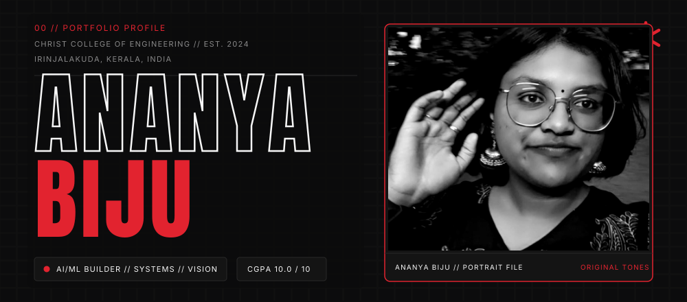
</picture>

  <a href="Ananya_Biju_Resume_2026.pdf"><strong>📄 Download / View Official Resume (PDF)</strong></a> &nbsp;•&nbsp;
  <a href="https://linkedin.com/in/ananyabiju"><strong>LinkedIn</strong></a> &nbsp;•&nbsp;
  <a href="https://github.com/itsananyaaa"><strong>GitHub</strong></a> &nbsp;•&nbsp;
  <a href="https://leetcode.com/u/ananyaaaabiju/"><strong>LeetCode</strong></a> &nbsp;•&nbsp;
  <a href="mailto:ananya.bijuks@gmail.com"><strong>Email</strong></a>

 

<!-- ================================================================= -->
<!-- 01 // ABOUT BENTO                                                 -->
<!-- ================================================================= -->

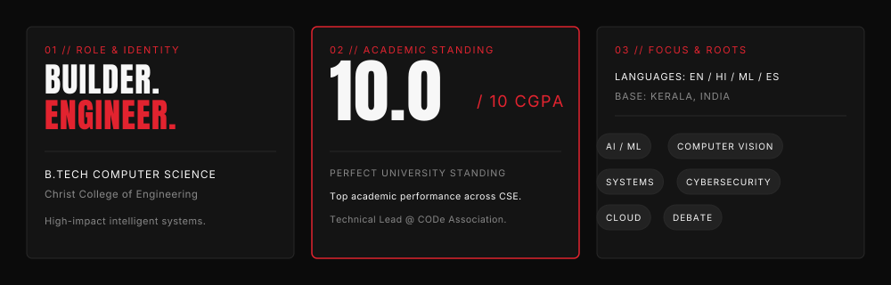

 

<!-- ================================================================= -->
<!-- 02 // NUMBERS (VERIFIED METRICS)                                  -->
<!-- ================================================================= -->

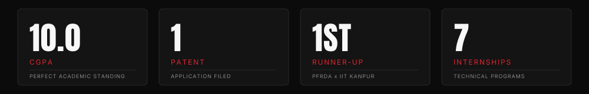

 

<!-- ================================================================= -->
<!-- 03 // WORK (FEATURED + PROJECT CARDS)                             -->
<!-- ================================================================= -->

<a href="https://github.com/itsananyaaa">
  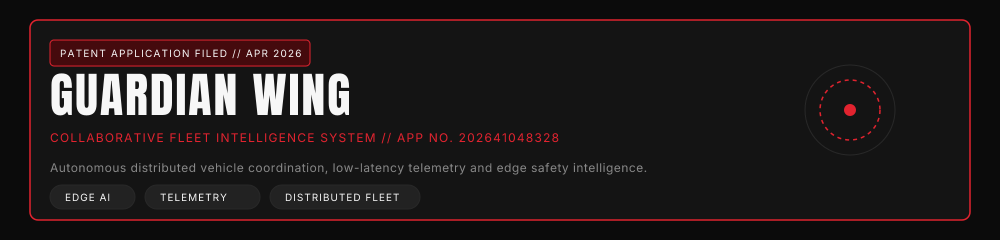
</a>

  ↳ <strong><a href="https://github.com/itsananyaaa">Guardian Wing</a></strong> — Collaborative Fleet Intelligence System <em>(Patent App. No. 202641048328)</em>

<table>
  <tr>
    <td width="50%" align="center">
      <a href="https://github.com/itsananyaaa/LucraLens_AI">
        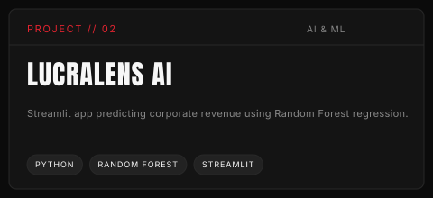
      </a>
       
      ↳ <a href="https://github.com/itsananyaaa/LucraLens_AI"><strong>itsananyaaa/LucraLens_AI</strong></a>
    </td>
    <td width="50%" align="center">
      <a href="https://github.com/itsananyaaa/roadsense-ai">
        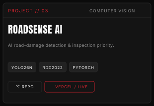
      </a>
       
      ↳ <a href="https://github.com/itsananyaaa/roadsense-ai"><strong>itsananyaaa/roadsense-ai</strong></a>
    </td>
  </tr>
  <tr>
    <td width="50%" align="center">
      <a href="https://github.com/itsananyaaa/PocketPlans">
        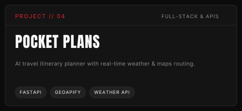
      </a>
       
      ↳ <a href="https://github.com/itsananyaaa/PocketPlans"><strong>itsananyaaa/PocketPlans</strong></a>
    </td>
    <td width="50%" align="center">
      <a href="https://github.com/itsananyaaa/AI_Network_Intrusion_System">
        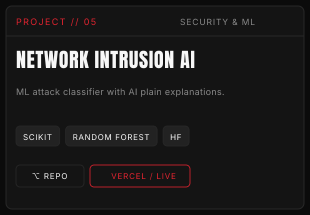
      </a>
       
      ↳ <a href="https://github.com/itsananyaaa/AI_Network_Intrusion_System"><strong>itsananyaaa/AI_Network_Intrusion_System</strong></a>
    </td>
  </tr>
  <tr>
    <td width="50%" align="center">
      <a href="https://github.com/itsananyaaa/deforestation_detection_system">
        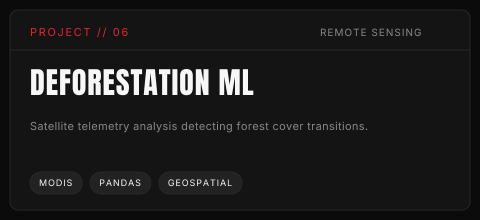
      </a>
       
      ↳ <a href="https://github.com/itsananyaaa/deforestation_detection_system"><strong>itsananyaaa/deforestation_detection_system</strong></a>
    </td>
    <td width="50%" align="center">
      <a href="https://github.com/itsananyaaa/NoteVerse">
        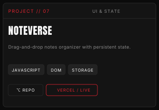
      </a>
       
      ↳ <a href="https://github.com/itsananyaaa/NoteVerse"><strong>itsananyaaa/NoteVerse</strong></a>
    </td>
  </tr>
</table>

  <strong>COMPLETE GITHUB REPOSITORIES & ENGINEERING WORK:</strong> 
  • <strong><a href="https://github.com/itsananyaaa/foodsync">FoodSync / FoodHub</a></strong> — Smart restaurant management & ordering platform (Java Spring Boot, REST APIs, Thymeleaf) 
  • <strong><a href="https://github.com/itsananyaaa/harry_potter_invisibility_cloak">Harry Potter Invisibility Cloak</a></strong> — Real-time color masking & background replacement CV (Python, OpenCV, NumPy) 
  • <strong><a href="https://github.com/itsananyaaa/Employee_Salary_Prediction_System">Employee Salary Predictor</a></strong> — Interactive compensation regression engine (Python, Streamlit, Scikit-learn) 
  • <strong><a href="https://github.com/itsananyaaa/FitPlan">FitPlan.ai</a></strong> — Health analytics and activity tracking ML engine (Infosys Springboard Project) 
  • <strong><a href="https://github.com/itsananyaaa/Keylogger-Application">Keylogger Application</a></strong> — Keystroke telemetry & security analysis tool (Python, pynput) 
  • <strong><a href="https://github.com/itsananyaaa/nps_saathi">NPS Saathi</a></strong> — National pension analytics platform (IIT Kanpur Hackathon Project, TypeScript) 
  • <strong><a href="https://github.com/itsananyaaa/drugrecallmonitor">Drug Recall Monitor</a></strong> — Real-time pharmaceutical safety monitor (Python) 
  • <strong><a href="https://github.com/itsananyaaa/diabetes_risk_predictor">Diabetes Risk Predictor</a></strong> — Clinical machine learning risk classification (Python, Streamlit) 
  • <strong><a href="https://github.com/itsananyaaa/Eloquent-Quiz-Application">Eloquent Quiz Application</a></strong> — Interactive frontend quiz platform (AICTE FWD, HTML, CSS, JS) 
  • <strong><a href="https://github.com/itsananyaaa">Cache Performance Analysis</a></strong> — Cache simulation & hit/miss analysis using Ripes (LRU, Random, CPI) 
  • <strong><a href="https://github.com/itsananyaaa">Pharmacy Management System</a></strong> — Relational inventory and supplier DBMS (In Progress, SQL) 
  • <strong><a href="https://github.com/itsananyaaa">Wireless Power Transfer</a></strong> — Inductive coupling contactless energy transfer hardware model

 

<!-- ================================================================= -->
<!-- 04 // TECH STACK (FULL RESUME SPECIFICATION)                      -->
<!-- ================================================================= -->

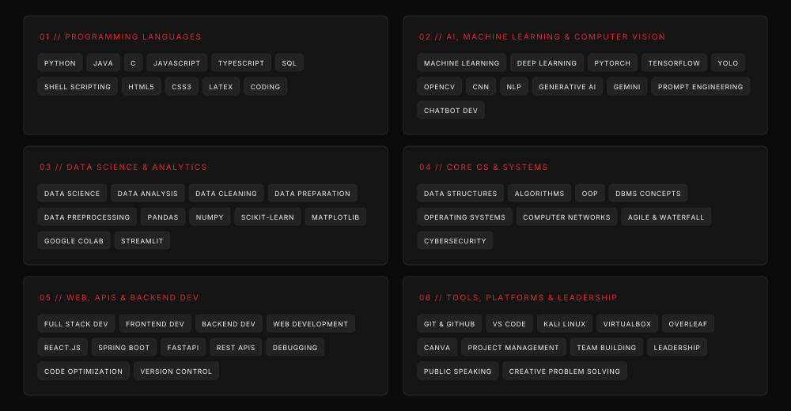

  <strong>TECHNICAL PROFICIENCIES (RESUME SOURCE):</strong> 
  • <strong>Programming Languages:</strong> Python, Java, C, JavaScript, HTML, CSS, SQL, Shell Scripting 
  • <strong>Core Computer Science:</strong> Data Structures & Algorithms, Object-Oriented Programming, Problem Solving, Operating Systems, DBMS Concepts 
  • <strong>Frameworks & Libraries:</strong> React.js, Bootstrap, Java Spring Boot, TensorFlow, NumPy, OpenCV, FastAPI, Pandas, Scikit-learn, Streamlit 
  • <strong>Tools & Platforms:</strong> Git & GitHub, Linux/Unix Shell, VS Code, Overleaf, Postman, VirtualBox, Kali Linux 
  • <strong>Software Engineering:</strong> Debugging, Code Optimization, Version Control, Writing Clean & Maintainable Code, Agile Methodologies, Team Leadership 
  • <strong>Areas of Focus:</strong> AI/ML, Computer Vision, Software Engineering, Distributed Systems, Cybersecurity, Cloud, Blockchain

 

<!-- ================================================================= -->
<!-- 05 // ACTIVITY SKYLINE (AUTHENTIC 365-DAY GITHUB RECORD)         -->
<!-- ================================================================= -->

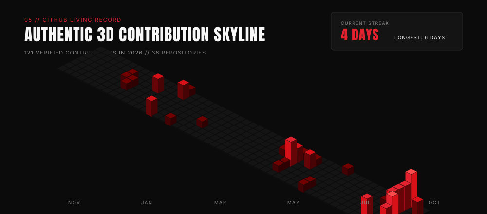

 

<!-- ================================================================= -->
<!-- 06 // WINS & HONOURS                                              -->
<!-- ================================================================= -->

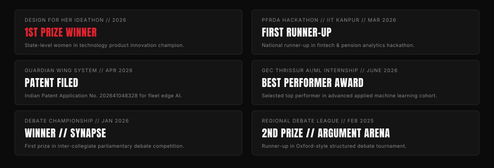

  <strong>KEY ACHIEVEMENTS & LEADERSHIP:</strong> 
  🥇 <strong>1st Prize Winner</strong> — Design for Her Ideathon (2026) 
  🥈 <strong>First Runner-Up</strong> — Pension Fund Regulatory and Development Authority (PFRDA) Hackathon @ IIT Kanpur (March 2026) 
  📜 <strong>Indian Patent Application Filed</strong> — <em>Guardian Wing: Collaborative Fleet Intelligence System</em> (App. No. 202641048328, April 2026) 
  🌟 <strong>Best Performer Award</strong> — Summer Internship Program ’26 @ Government Engineering College (GEC), Thrissur (June 2026) 
  🏆 <strong>Winner</strong> — SYNAPSE Debate Competition (January 2026) 
  🥈 <strong>Second Prize</strong> — Argument Arena Debate Competition (February 2025) 
  🛡️ <strong>Shortlisted</strong> — Smart India Hackathon (SIH 2025) Internal Round (October 2025) 
  🥉 <strong>3rd Prize</strong> — Micropresentation Competition (August 2025) 
  ⚡ <strong>Technical Lead</strong> — CODe (Department of Computer Science & Engineering Association)

 

<!-- ================================================================= -->
<!-- 07 // TRACK RECORD (7 INTERNSHIP PROGRAMS)                         -->
<!-- ================================================================= -->

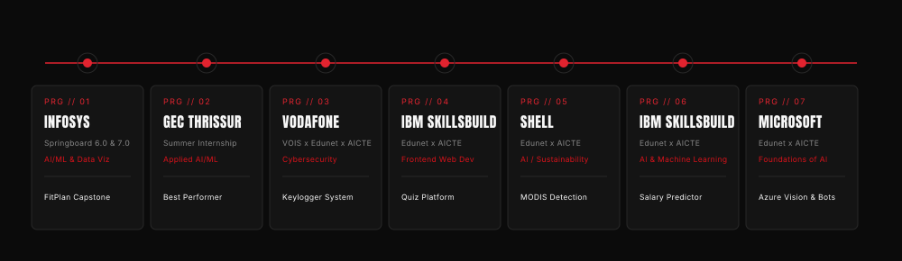

  <strong>STRUCTURED TECHNICAL INTERNSHIPS:</strong> 
  1. <strong>Infosys Springboard Virtual Internship 6.0 & 7.0</strong> (Dec 2025, July 2026) — AI/ML, Data Visualization, FitPlan.ai Capstone (Team Lead) 
  2. <strong>GEC Thrissur Summer Internship</strong> (June 2026) — Applied AI/ML & Compensation Analytics (<em>Awarded Best Performer</em>) 
  3. <strong>Vodafone & VOIS Idea Foundation x Edunet x AICTE</strong> (Dec 2025) — Cybersecurity, Keylogger & Network Intrusion Systems 
  4. <strong>IBM SkillsBuild x Edunet x AICTE</strong> (Aug 2025) — Frontend & Web Development, Interactive UI/UX Quiz Application 
  5. <strong>Shell x Edunet x AICTE</strong> (July 2025) — Artificial Intelligence & Machine Learning, MODIS Deforestation Detection (SDG Aligned) 
  6. <strong>IBM SkillsBuild x Edunet x AICTE</strong> (June 2025) — AI & Machine Learning, Employee Salary Prediction System 
  7. <strong>Microsoft x Edunet x AICTE</strong> (April 2025) — Foundations of AI, Azure Custom Vision, Neural Network Chatbots

 

<!-- ================================================================= -->
<!-- 08 // OFF-DUTY BENTO (CAT BOBBY, READING, DEBATE, COMMUNITY)      -->
<!-- ================================================================= -->

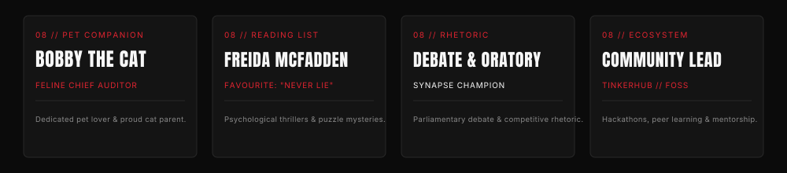

 

<!-- ================================================================= -->
<!-- 09 // SAY HI & SOCIALS                                            -->
<!-- ================================================================= -->

  <a href="Ananya_Biju_Resume_2026.pdf"><strong>📄 Official Resume (PDF)</strong></a> &nbsp;•&nbsp;
  <a href="https://linkedin.com/in/ananyabiju"><strong>LinkedIn</strong></a> &nbsp;•&nbsp;
  <a href="https://github.com/itsananyaaa"><strong>GitHub</strong></a> &nbsp;•&nbsp;
  <a href="https://leetcode.com/u/ananyaaaabiju/"><strong>LeetCode</strong></a> &nbsp;•&nbsp;
  <a href="mailto:ananya.bijuks@gmail.com"><strong>Email</strong></a>

