

<!-- ================================================================= -->
<!-- 00 // HERO BANNER                                                 -->
<!-- ================================================================= -->

<picture>
  <source media="(prefers-color-scheme: dark)" srcset="assets/hero/hero_banner.svg">
  <source media="(prefers-color-scheme: light)" srcset="assets/hero/hero_banner.svg">
  
</picture>

 

  

 

<!-- ================================================================= -->
<!-- 01 // ABOUT BENTO                                                 -->
<!-- ================================================================= -->

 

<!-- ================================================================= -->
<!-- 02 // NUMBERS (VERIFIED METRICS)                                  -->
<!-- ================================================================= -->

 

<!-- ================================================================= -->
<!-- 03 // LEADERSHIP & ORGANIZATIONS                                  -->
<!-- ================================================================= -->

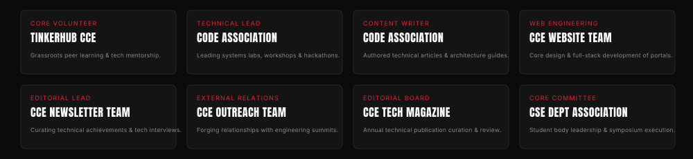

 

<!-- ================================================================= -->
<!-- 04 // ACTIVE CLUBS & COMMUNITIES (SLIDING CAROUSEL)               -->
<!-- ================================================================= -->

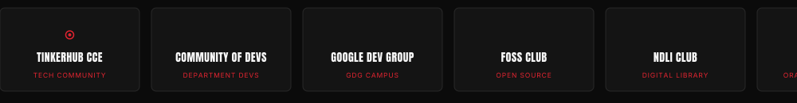

 

<!-- ================================================================= -->
<!-- 05 // WORK (100% VISUAL CARDS // 3 PER LINE + REPO & VERCEL LINKS)-->
<!-- ================================================================= -->

  

<table border="0" cellpadding="0" cellspacing="10" width="100%">
  <!-- ROW 1 -->
  <tr>
    <td width="33.3%" align="center" valign="top">
      
      

         &nbsp;
        
      

    </td>
    <td width="33.3%" align="center" valign="top">
      
      

         &nbsp;
        
      

    </td>
    <td width="33.3%" align="center" valign="top">
      
      

         &nbsp;
        
      

    </td>
  </tr>
  <!-- ROW 2 -->
  <tr>
    <td width="33.3%" align="center" valign="top">
      
      

         &nbsp;
        
      

    </td>
    <td width="33.3%" align="center" valign="top">
      
      

         &nbsp;
        
      

    </td>
    <td width="33.3%" align="center" valign="top">
      
      

         &nbsp;
        
      

    </td>
  </tr>
  <!-- ROW 3 -->
  <tr>
    <td width="33.3%" align="center" valign="top">
      <a href="https://github.com/itsananyaaa/foodsync">
        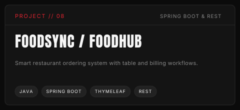
      </a>
      

         &nbsp;
        
      

    </td>
    <td width="33.3%" align="center" valign="top">
      <a href="https://github.com/itsananyaaa/harry_potter_invisibility_cloak">
        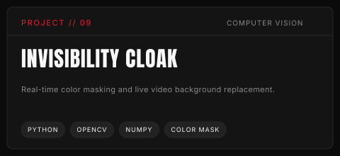
      </a>
      

         &nbsp;
        
      

    </td>
    <td width="33.3%" align="center" valign="top">
      <a href="https://github.com/itsananyaaa/Employee_Salary_Prediction_System">
        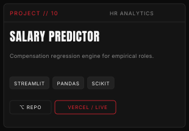
      </a>
      

         &nbsp;
        
      

    </td>
  </tr>
  <!-- ROW 4 -->
  <tr>
    <td width="33.3%" align="center" valign="top">
      <a href="https://github.com/itsananyaaa/FitPlan">
        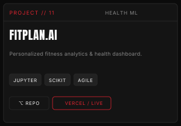
      </a>
      

         &nbsp;
        
      

    </td>
    <td width="33.3%" align="center" valign="top">
      <a href="https://github.com/itsananyaaa/Keylogger-Application">
        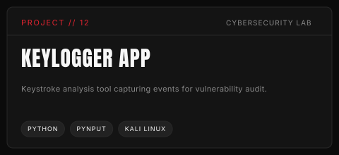
      </a>
      

         &nbsp;
        
      

    </td>
    <td width="33.3%" align="center" valign="top">
      <a href="https://github.com/itsananyaaa/nps_saathi">
        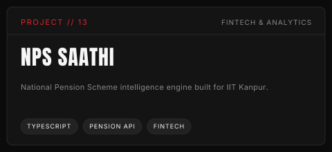
      </a>
      

         &nbsp;
        
      

    </td>
  </tr>
  <!-- ROW 5 -->
  <tr>
    <td width="33.3%" align="center" valign="top">
      <a href="https://github.com/itsananyaaa/drugrecallmonitor">
        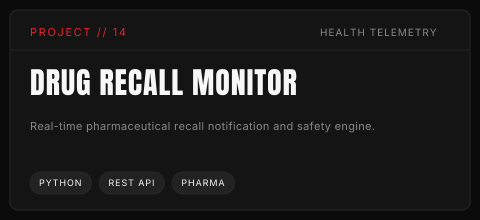
      </a>
      

         &nbsp;
        
      

    </td>
    <td width="33.3%" align="center" valign="top">
      <a href="https://github.com/itsananyaaa/diabetes_risk_predictor">
        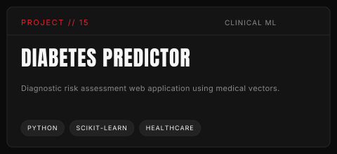
      </a>
      

         &nbsp;
        
      

    </td>
    <td width="33.3%" align="center" valign="top">
      <a href="https://github.com/itsananyaaa/Eloquent-Quiz-Application">
        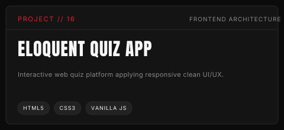
      </a>
      

         &nbsp;
        
      

    </td>
  </tr>
  <!-- ROW 6 -->
  <tr>
    <td width="33.3%" align="center" valign="top">
      <a href="https://github.com/itsananyaaa">
        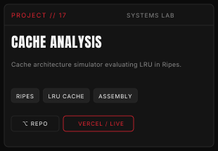
      </a>
      

         &nbsp;
        
      

    </td>
    <td width="33.3%" align="center" valign="top">
      <a href="https://github.com/itsananyaaa">
        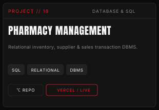
      </a>
      

         &nbsp;
        
      

    </td>
    <td width="33.3%" align="center" valign="top">
      <a href="https://github.com/itsananyaaa">
        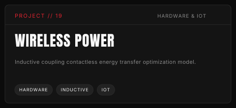
      </a>
      

         &nbsp;
        
      

    </td>
  </tr>
</table>

 

<!-- ================================================================= -->
<!-- 06 // TECH STACK (100% VISUAL BLOCKS)                             -->
<!-- ================================================================= -->

 

<!-- ================================================================= -->
<!-- 07 // ACTIVITY SKYLINE (AUTHENTIC 3D ISOMETRIC RECORD)            -->
<!-- ================================================================= -->

 

<!-- ================================================================= -->
<!-- 08 // WINS & HONOURS (100% CARDS FORMAT)                          -->
<!-- ================================================================= -->

 

<!-- ================================================================= -->
<!-- 09 // KEY EVENTS COORDINATED (100% CARDS FORMAT)                  -->
<!-- ================================================================= -->

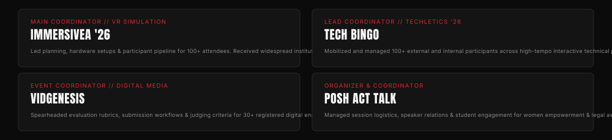

 

<!-- ================================================================= -->
<!-- 10 // HACKATHONS, IDEATHONS & CONFERENCES (100% CARDS FORMAT)     -->
<!-- ================================================================= -->

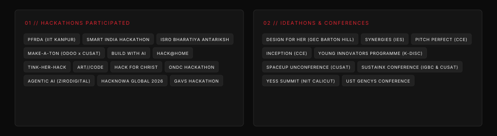

 

<!-- ================================================================= -->
<!-- 11 // TRACK RECORD (FLOWCHART TIMELINE)                           -->
<!-- ================================================================= -->

 

<!-- ================================================================= -->
<!-- 12 // OFF-DUTY BENTO (CAT BOBBY, READING, DEBATE, ECOSYSTEM)      -->
<!-- ================================================================= -->

  

<!-- ================================================================= -->
<!-- 13 // SAY HI & SOCIALS (WORKING DEDICATED BUTTONS)                -->
<!-- ================================================================= -->

  

  <a href="https://raw.githubusercontent.com/itsananyaaa/itsananyaaa/main/Ananya_Biju_Resume_2026.pdf" target="_blank">
    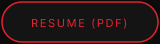
  </a> &nbsp;
  <a href="https://linkedin.com/in/ananyabiju" target="_blank">
    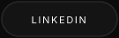
  </a> &nbsp;
  <a href="https://github.com/itsananyaaa" target="_blank">
    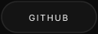
  </a> &nbsp;
  <a href="https://leetcode.com/u/ananyaaaabiju/" target="_blank">
    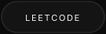
  </a> &nbsp;
  <a href="https://www.goodreads.com/ananyabiju" target="_blank">
    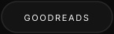
  </a> &nbsp;
  <a href="mailto:ananya.bijuks@gmail.com">
    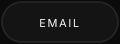
  </a>

 

