# The Crimson Archive

**A classified collection of ideas, experiments and engineered realities.**

Ananya Biju. Computer science and engineering, Christ College of Engineering, Irinjalakuda. The work below is the part that can be opened: studies, systems, and a patent application that has been filed and not granted.

## The Grimoire

  

> The world is full of things that have not yet been built.

  

## The Archive Index

This is a record, not an introduction.

| | |
| --- | --- |
| Name | Ananya Biju |
| Programme | B.Tech Computer Science and Engineering, 2024–2028 |
| Station | Christ College of Engineering, Irinjalakuda, Kerala |
| Standing | CGPA 10/10 |
| Languages | English, Hindi, Malayalam, basic Spanish |

She works across machine learning, computer vision, cybersecurity, and software engineering, with the habits those fields actually require: data structures, object-oriented design, databases, operating systems, debugging, and a preference for making a thing smaller until it is clear. The tools she uses in that work are Python, Java, C, JavaScript, HTML, CSS, SQL, and the shell; React, Bootstrap, and Spring Boot; TensorFlow, NumPy, and OpenCV; Git, Linux, VS Code, Streamlit, and Overleaf.

The current practice is applied learning rather than a single job title. Generative models, perception, and defensive security sit next to ordinary software: an interface, a service, a schema. She also debates, writes, and reads. On 7 November 2026 the public LeetCode profile [ananyaaaabiju](https://leetcode.com/u/ananyaaaabiju/) showed 66 accepted solutions — 57 easy, 9 medium, none hard — mostly in Python 3, with 10 in C and 2 in MySQL.

A model is a claim about the world. It earns its place when a person can see what it was trained on, what it refuses to do, and what happens when it is wrong. The same standard applies to a page of prose and to a system under load. Curiosity is not a substitute for that standard.

### Fieldwork

The internships are not one role repeated.

**Government Engineering College, Thrissur.** AI/ML summer internship, June 2026. Status: completed. Distinction: Best Performer. The public study from that internship is [LucraLens AI](https://github.com/itsananyaaa/LucraLens_AI).

**Infosys Springboard.** Virtual Internship 6.0, December 2025, and Virtual Internship 7.0, in AI/ML and data visualisation. On 6.0 she was temporary team lead for [FitPlan](https://github.com/itsananyaaa/FitPlan): documentation, backend, data preprocessing, visualisation, integration, and testing, with mentor sessions on Agile and GitHub. No separate public repository was found for 7.0.

Earlier programmes

**Vodafone / VOIS, with Edunet Foundation and AICTE.** Cybersecurity, December 2025. The public study is the [network intrusion repository](https://github.com/itsananyaaa/AI_Network_Intrusion_System). The same training included a keylogger, written to study capture from the defensive side, on Kali Linux and VirtualBox. [That exercise](https://github.com/itsananyaaa/Keylogger-Application) is not on the shelves.

**IBM SkillsBuild.** Frontend and web development, August 2025. Hands-on HTML, CSS, JavaScript, responsive layout, and the [Eloquent Quiz Application](https://github.com/itsananyaaa/Eloquent-Quiz-Application) as capstone.

**Shell, with Edunet Foundation and AICTE.** AI/ML, July 2025. Sustainability problems aligned with the SDGs, and a deforestation-detection study on MODIS satellite data. The public notebook is the [MODIS repository](https://github.com/itsananyaaa/deforestation_detection_system).

**IBM SkillsBuild.** AI/ML, June 2025. Data preprocessing, training, and evaluation, and the [Employee Salary Prediction](https://github.com/itsananyaaa/Employee_Salary_Prediction_System) application.

**Microsoft, with Edunet Foundation and AICTE.** Foundations of AI, April 2025. Supervised and unsupervised models, computer vision and generative AI through Azure Custom Vision, and an AI chatbot as capstone. That chatbot has no public repository.

  

## Shelves of Obsession

Each volume is a public repository unless the entry says otherwise. A cover is an illustration. The name, the description, and the link are the record. Nothing here is described as deployed unless the address answered.

### Guardian Wing

  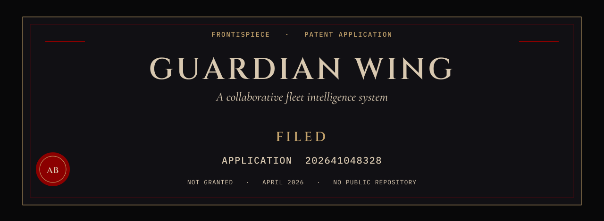

Collaborative fleet intelligence system. Indian patent **application filed**, number **202641048328**, April 2026. It has not been granted. There is no public repository, and this page does not pretend otherwise.

### Vol. I — AI and ML

<a href="https://github.com/itsananyaaa/LucraLens_AI">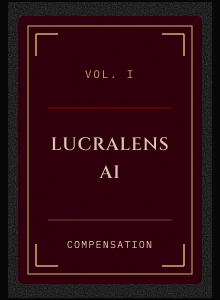</a>

**LucraLens AI.** A compensation model for technology salaries, built as the final project of the GEC Thrissur AI/ML internship. The training notebook fits a random-forest regressor. The interface is a Streamlit application. No public deployment was found.

Python, scikit-learn, Streamlit. [Repository](https://github.com/itsananyaaa/LucraLens_AI).

**Employee Salary Prediction.** The June 2025 IBM SkillsBuild AI/ML build: a Streamlit estimator over the same public salary table as LucraLens, covering experience, employment type, role, company size, location, and remote ratio. The notebook and the application are different files, and the repository does not name the algorithm. No public deployment.

Python, Streamlit. [Repository](https://github.com/itsananyaaa/Employee_Salary_Prediction_System).

<a href="https://github.com/itsananyaaa/deforestation_detection_system">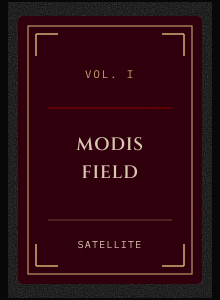</a>

**MODIS field notes.** The repository is named `deforestation_detection_system` and is described as an AICTE internship project. The notebook that is actually checked in classifies fire types from MODIS satellite scenes for India, 2021 to 2023. This page does not add a deforestation score the notebook does not show.

Python, Jupyter. [Repository](https://github.com/itsananyaaa/deforestation_detection_system).

### Vol. II — Computer Vision and Perception

<a href="https://github.com/itsananyaaa/harry_potter_invisibility_cloak">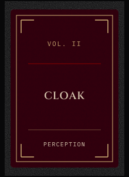</a>

**Invisibility cloak.** A webcam study. Cloth in a yellow range is masked in HSV and replaced with a captured background, in real time, with OpenCV and NumPy. It runs locally. There is no deployment.

Python, OpenCV, NumPy. [Repository](https://github.com/itsananyaaa/harry_potter_invisibility_cloak).

<a href="https://github.com/itsananyaaa/roadsense-ai">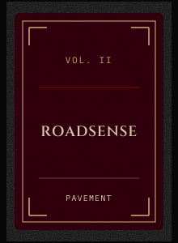</a>

**RoadSense AI.** Road-damage detection and an inspection-priority platform, built on the RDD2022 benchmark and a YOLO model. The repository's own description is the claim; this page does not repeat benchmark scores. No public deployment was found.

Python. [Repository](https://github.com/itsananyaaa/roadsense-ai).

### Vol. III — Cybersecurity and Digital Defence

<a href="https://github.com/itsananyaaa/AI_Network_Intrusion_System">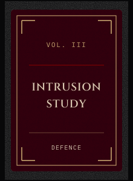</a>

**Network intrusion study.** A random-forest classifier trained on a CIC-IDS2017 DDoS subset, with a Streamlit surface that can ask Groq to explain a flagged flow. It is a student project. The explanations require an API key supplied at runtime. No public deployment was found.

Python, scikit-learn, Streamlit. [Repository](https://github.com/itsananyaaa/AI_Network_Intrusion_System).

### Vol. IV — Software Engineering and Systems

**Pocket Plans.** A travel roadmap rather than a single suggestion: mood, time, and place go in; a short sequence of stops comes out, using Geoapify and OpenWeatherMap, with navigation links. Ananya Biju is named on the team with Annrose P. T. The public repository is a fork of the TinkerHub hackathon project `tink-her-hack-temp`. The README still has a placeholder where a hosted link would go, so there is no live address here.

Python, FastAPI, JavaScript. [Repository](https://github.com/itsananyaaa/Pocket_Plans).

<a href="https://github.com/itsananyaaa/NoteVerse">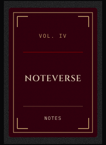</a>

**NoteVerse.** A browser notebook. Each line can carry a checkbox, notes can be reordered by dragging, and nothing is stored on a server. HTML, CSS, and JavaScript only. No deployment.

[Repository](https://github.com/itsananyaaa/NoteVerse).

<a href="https://github.com/itsananyaaa/thesilentindex">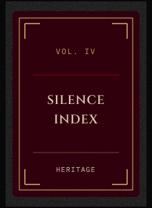</a>

**The Silence Index.** A diagnostic for what an Indian heritage collection documents, and what it leaves out. Built with Angel Maria Ben for the ART CODE hackathon. The repository states a FastAPI service and a Next.js interface.

The site and the health check both answered on 7 November 2026: [thesilentindex.vercel.app](https://thesilentindex.vercel.app) and [the API health endpoint](https://thesilentindex-backend.onrender.com/api/health). [Repository](https://github.com/itsananyaaa/thesilentindex).

### Appendix

Quiet entries. Still true, still not dressed up as more than they are.

Work with a thin public record, and work with no repository at all

- **FitPlan.** Collaborative Infosys Springboard 6.0 project. She was temporary team lead: documentation, backend, preprocessing, visualisation, integration, and testing. The repository README itself does not describe a feature list. [Repository](https://github.com/itsananyaaa/FitPlan).
- **Eloquent Quiz Application.** Frontend internship capstone. The repository is a single HTML document and calls itself an AICTE frontend project. [Repository](https://github.com/itsananyaaa/Eloquent-Quiz-Application).
- **SahAI.** Maternal-health decision support, marked work in progress in its own repository. [Repository](https://github.com/itsananyaaa/sahai).
- **Drug Recall Monitor.** A hackathon build with Alvino P. Shatto and Ann Sani, marked work in progress in the repository. [Repository](https://github.com/itsananyaaa/drugrecallmonitor).
- **NPS Saathi.** A public assistant for the National Pension System. The repository does not identify it as the PFRDA hackathon submission, so this page does not either. [Repository](https://github.com/itsananyaaa/nps_saathi).
- **FoodHub.** Full-stack restaurant ordering, named in the supplied record as Spring Boot, Thymeleaf, and REST. No public repository under that name was found, so it is not linked.
- **Pharmacy management.** An ongoing database project in the supplied record. No public repository.
- **Cache performance.** A study of cache behaviour and replacement policies in Ripes, in the supplied record. No public repository.

  

## Neural Constellation

  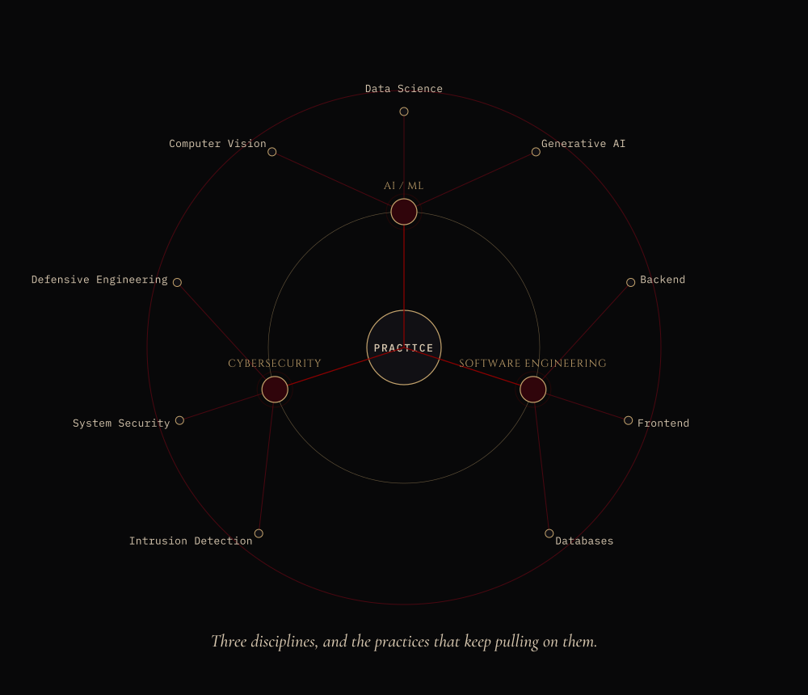

The drawing is generated from [`data/constellation.json`](data/constellation.json). The relationships, in words:

- **AI / ML** pulls toward computer vision, data science, and generative AI.
- **Software engineering** pulls toward backend work, frontend work, and databases.
- **Cybersecurity** pulls toward intrusion detection, system security, and defensive engineering.

  

## The Classified Files

The patent, the hackathons, the internship distinction, and the academic record come first. The rest of the record follows in the same hand, without badges.

**Patent.** Guardian Wing, collaborative fleet intelligence. Indian patent application **202641048328**, filed April 2026. Filed is not granted.

**Hackathons.** First runner-up, PFRDA Hackathon, IIT Kanpur, March 2026. Internal-round shortlist, Smart India Hackathon 2025.

**Internship.** Best Performer, Government Engineering College Thrissur, AI/ML summer internship, June 2026. The wider ledger is above: Infosys Springboard 6.0 and 7.0, Vodafone/VOIS, IBM SkillsBuild (frontend, and a separate AI/ML programme), Shell, and Microsoft.

**Academic.** B.Tech computer science and engineering, Christ College of Engineering, 2024–2028. CGPA 10/10.

**Speaking.** Winner, SYNAPSE debate, January 2026. Second prize, Argument Arena debate, February 2025. Third prize, micropresentation, August 2025. Technical lead of CODe.

**Quiz.** Top 10, Fortress of Facts engineering quiz, February 2025.

**Events coordinated.** Perception vs Potential, an invited talk, March 2026. IMMERSIVEA '26, a VR simulation, February 2026. Tech Bingo and VidGenesis, Techletics '26, January 2026.

**Conferences.** SpaceUp Unconference, CUSAT, January 2026. BeachHack Season 7, Ocean Panel, January 2026. UST GenCyS cybersecurity conference, August 2025. SustainX, IGBC and CUSAT, March 2025. Young Innovators Program, K-DISC, January 2025.

**Courses.** Python for Data Science, NPTEL, Elite. Microsoft Learn: AI, computer vision, NLP, generative AI, and AI fluency. Infosys Springboard: AI, NLP, data science, and soft skills. Accenture software-engineering job simulation. Deloitte cyber-security analyst job simulation. Digital 101, 30 hours, Gold. Java Spring Boot, iPlus Solutions.

**Rooms she works in.** TinkerHub, FOSS, Women Techmakers, and Google Developer communities.

  

## The Living Archive

These plates are drawn from the public GitHub API and stored in the repository, so the page still reads when a third-party stats service does not. A weekly Action refreshes them with the built-in token and writes only this section and `assets/stats/`. There is no view counter.

<!-- living-archive:start -->
Public GitHub record for `itsananyaaa`, fetched 2026-11-06T20:51:05Z. Contribution counts are the public calendar from 2025-11-07 to 2026-11-06. Language share and stars exclude forks, so an upstream copy cannot dominate the shelf. The streak counts backward from the latest day; if that day is today and still empty, it starts from yesterday.

| Record | Figure |
| --- | ---: |
| Public repositories | 36 |
| Public repositories that are not forks | 32 |
| Stars on those non-fork repositories | 3 |
| Public contributions in the window | 121 |
| Current public streak | 4 days |
| Longest public streak in the window | 6 days |

| Language | Bytes | Share |
| --- | ---: | ---: |
| Jupyter Notebook | 19,066,163 | 84.1% |
| TypeScript | 1,441,993 | 6.4% |
| Python | 1,401,300 | 6.2% |
| HTML | 296,155 | 1.3% |
| JavaScript | 274,509 | 1.2% |
| CSS | 157,893 | 0.7% |

Jupyter Notebook leads the byte count because a notebook file stores outputs as well as source. Read that share as file weight, not as hours spent.

The same figures are drawn in `assets/stats/`. A failed refresh leaves this snapshot in place.
<!-- living-archive:end -->

  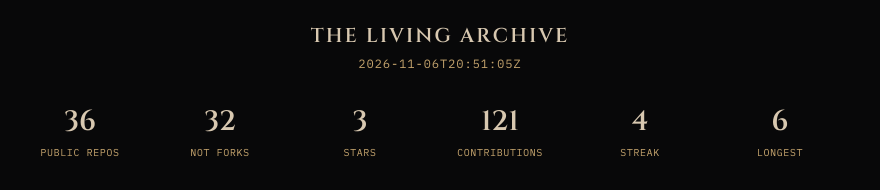

  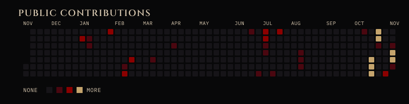

  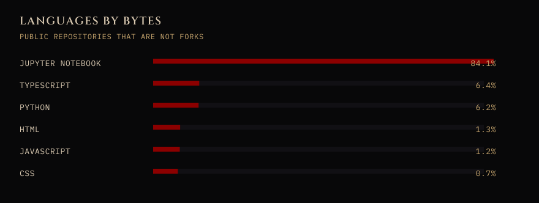

  

## The Reading Room

  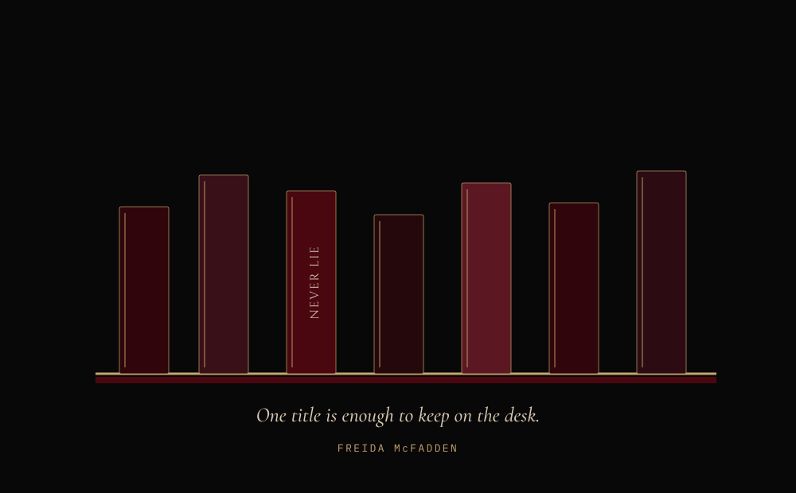

One title is named because one title was given. *Never Lie*, by Freida McFadden, is the novel she returns to. The other spines stay blank. Inventing a personal canon would be a kind of forgery, and this archive has no use for that.

Reading and engineering share a second pass. The first pass takes the plot, or the happy path. The second asks what was withheld: a missing case, a quiet assumption, a sentence that only works if the reader agrees not to look. She wants systems that can survive that second reading, and stories that reward it.

  

## The Final Seal

  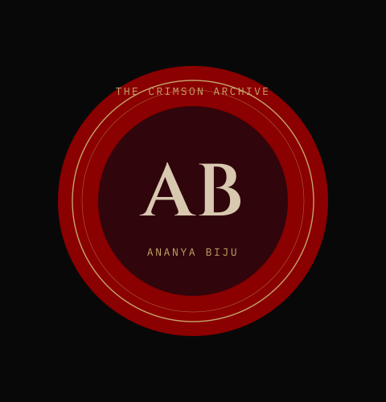

The archive stays open for work that can survive daylight.

Correspondence is welcome: internships, research, and things that have not been built yet.

[LinkedIn](https://www.linkedin.com/in/ananyabiju/) · [GitHub](https://github.com/itsananyaaa) · [LeetCode](https://leetcode.com/u/ananyaaaabiju/) · [Email](mailto:ananya.bijuks@gmail.com)

  

